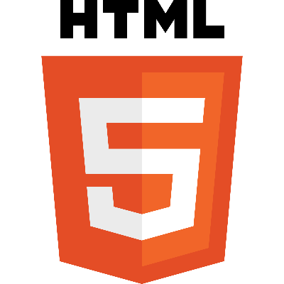
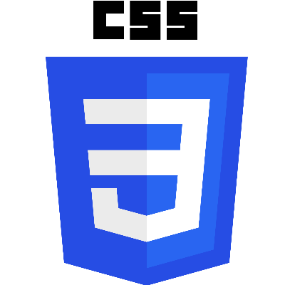
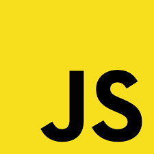
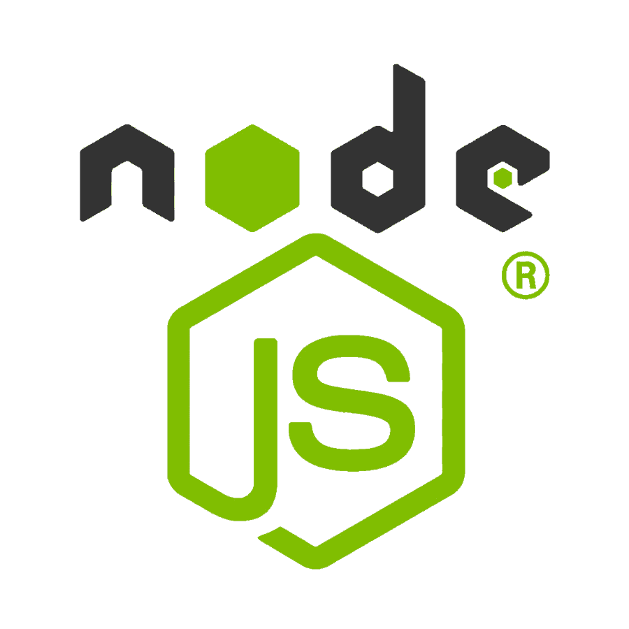
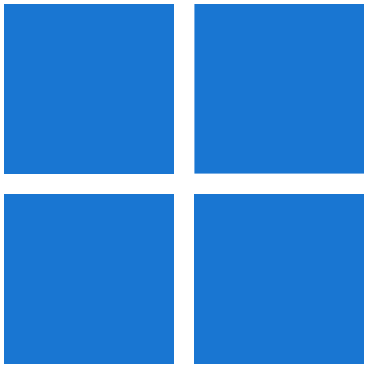
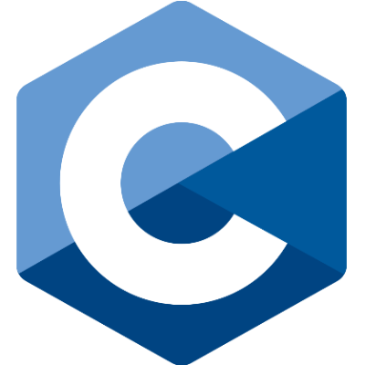
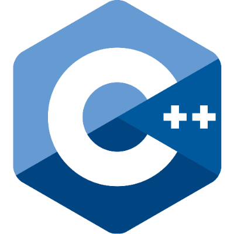
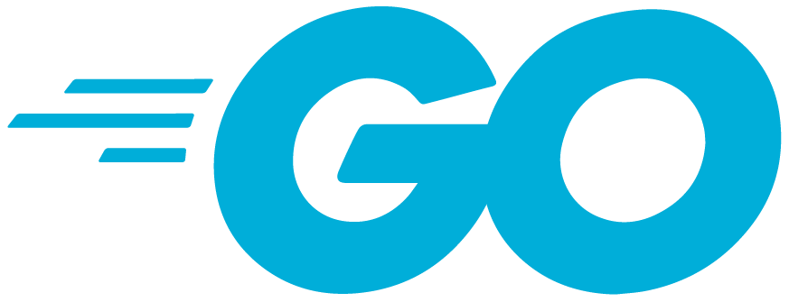

<h1>Hi 👋, I'm Morris</h1>

I develop applications, websites and scripts

<h2>🚀Stuff I Use</h2>

	<code></code>
	<code></code>
	<code></code>
	<code></code>
	<code></code>
	<code></code>
	<code></code>
	<code></code>
	<code></code>
	<code></code>
	<code></code>

  
<h2>🎭 Memes (Click to open)</h2>

  
  

    
     
    <em>Absolute Terminal</em>
  

