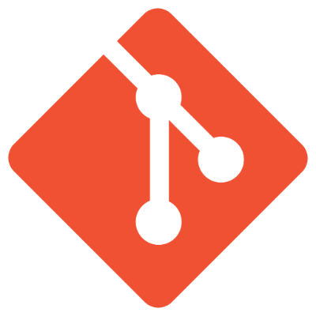
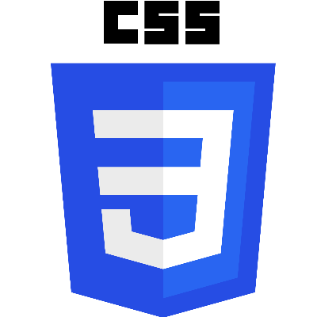
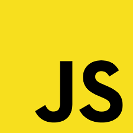
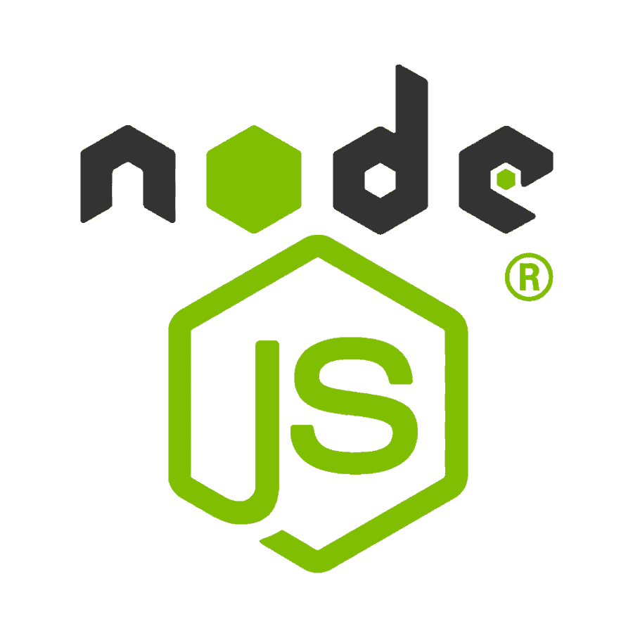
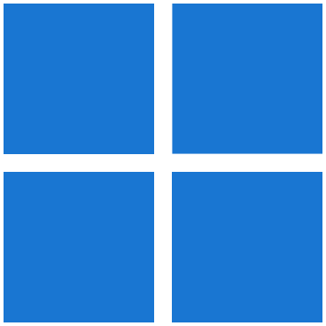
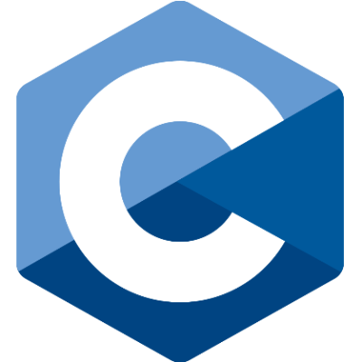
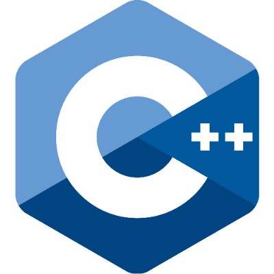
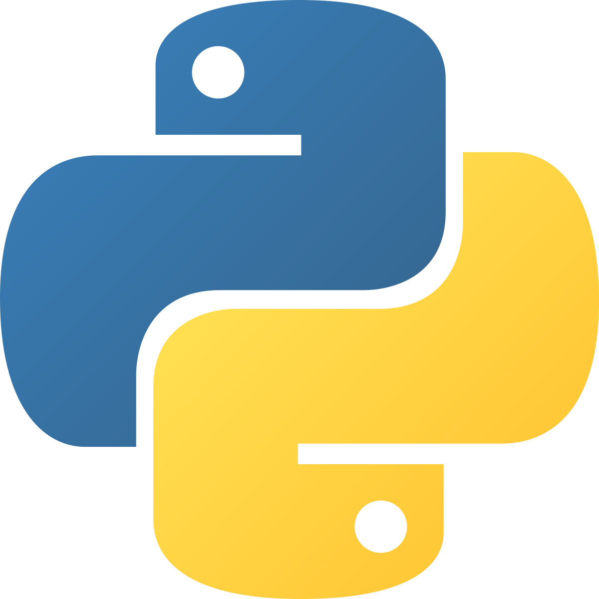
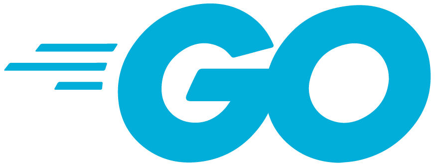
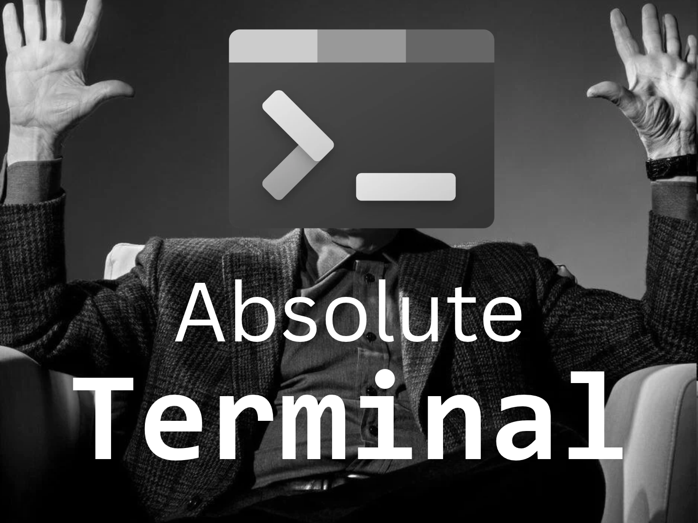

<h1>Hi 👋, I'm Morris</h1>

I develop applications, websites and scripts

<h2>🚀 Stuff I Use</h2>

	&nbsp;&nbsp;
	&nbsp;&nbsp;
	&nbsp;&nbsp;
	&nbsp;&nbsp;
	&nbsp;&nbsp;
	&nbsp;&nbsp;
	&nbsp;&nbsp;
	&nbsp;&nbsp;
	&nbsp;&nbsp;
	

---

	

